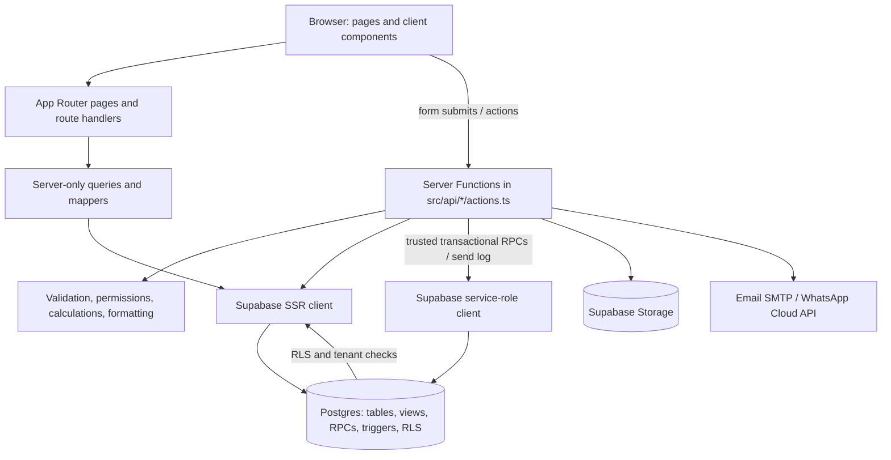
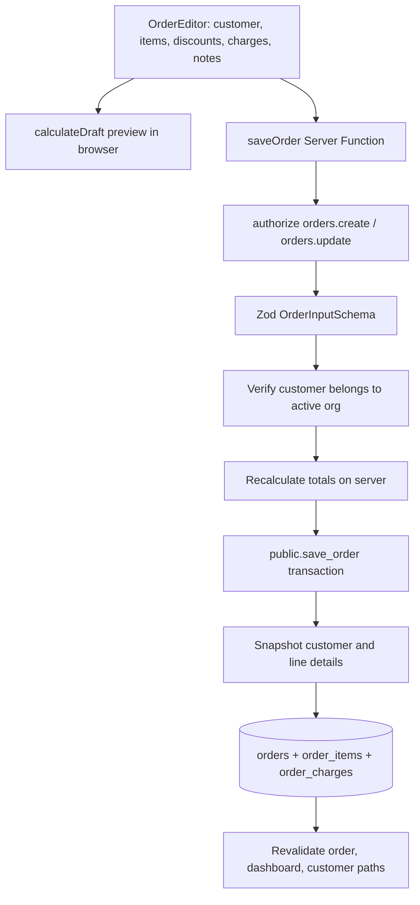
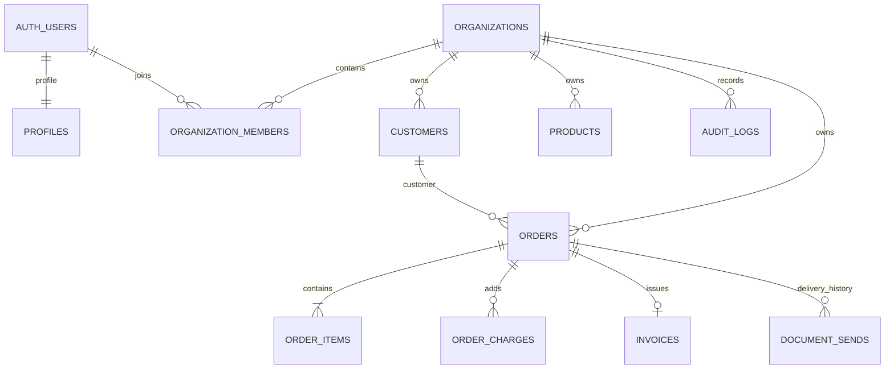

# Developer guide

This guide describes how the application works from a user action through the UI, server code, and database. It is based on the current source and Supabase migrations. The project uses Next.js 16 App Router; route groups in parentheses organize layouts without appearing in URLs.

## What the app does

Invoice SaaS lets users work in an organization to manage a product catalogue and customers, create GST-aware orders, issue invoices, mark invoices paid, and send order/invoice PDFs by email or WhatsApp. Organizations have members with roles and permissions. PostgreSQL row-level security (RLS) is the final tenant and permission boundary.

## Architecture at a glance



### Dependency boundaries

- `src/app` owns routes, layouts, and presentation. Most route pages load server data and render a feature component.
- `src/api` owns server-side access: Supabase clients, queries, Server Functions, document delivery, and PDF creation. Query modules use `server-only` where appropriate.
- `src/utils`, `src/types`, and `src/constants` contain shared rules and data contracts. They should not depend on `app` or `api`.
- `supabase/migrations` is the source of truth for database structure and SQL workflows. `src/types/database.ts` is generated from the local schema by `pnpm db:types`.

## Request and access workflow

```mermaid
sequenceDiagram
  participant B as Browser
  participant P as src/proxy.ts
  participant L as Dashboard layout
  participant A as authorize()
  participant S as Supabase / Postgres
  B->>P: Request route
  P->>S: Validate claims and refresh session cookies
  P-->>B: Redirect signed-out user to login when needed
  B->>L: Request protected dashboard page
  L->>S: requireOrganization(): user + memberships
  L-->>B: AppShell + OrganizationProvider
  B->>A: Invoke Server Function
  A->>S: Resolve current org and role permission
  A->>S: Query or mutate using session client / RPC
  S->>S: Apply RLS, tenant scope, database invariants
  S-->>B: Result; action revalidates affected paths
```

`src/proxy.ts` delegates to `src/api/supabase/proxy.ts`. It refreshes Supabase auth cookies and provides optimistic login-page redirects. It is not the security boundary: protected layouts call `requireOrganization`, Server Functions call `authorize`, and Postgres RLS/RPC checks enforce access again.

`src/api/auth/session.ts` uses verified JWT claims, retrieves the profile and organization memberships, and selects the organization named by the HTTP-only active-organization cookie when the user remains a member. If there are no memberships, the user is sent to onboarding. `authorize(permission)` returns the full organization context only when the current role has that permission.

`src/api/supabase/server.ts` creates a request-scoped SSR client that reads/writes session cookies. `src/api/supabase/admin.ts` creates a service-role client for narrow trusted server operations (for example transactional order saving, public share-token lookup, and send logging). Keep the service-role client out of browser code; it bypasses RLS.

## Routes and screens

| URL | Purpose | Main code |
| --- | --- | --- |
| `/` | Redirect signed-in users to home; otherwise login | `src/app/(main)/page.tsx` |
| `/login`, `/signup`, `/forgot-password`, `/reset-password` | Supabase authentication flows | `src/app/(main)/(auth)/*/page.tsx`, `src/api/auth/actions.ts` |
| `/onboarding` | Create/select initial organization | auth page + `src/api/organizations/actions.ts` |
| `/dashboard` | Organization sales overview | dashboard page + `src/api/dashboard/queries.ts` |
| `/products`, `/products/new`, `/products/:id/edit` | Product catalogue and archive/edit forms | `src/api/products/*`, product components |
| `/customers`, `/customers/new`, `/customers/:id`, `/customers/:id/edit` | Customer list and lifecycle | `src/api/customers/*`, customer components |
| `/orders`, `/orders/new`, `/orders/:id`, `/orders/:id/edit` | Orders and invoices workflow | `src/api/orders/*`, order components |
| `/orders/:id/invoice` | Invoice presentation/print view | invoice route + `InvoiceView` |
| `/orders/:id/pdf` | Inline or downloadable PDF response | route handler + `src/api/orders/pdf/*` |
| `/share/:token` | Public order document via unguessable share token | `src/app/(main)/share/[token]/route.ts` |
| `/design` | Internal component showcase | design page + `Showcase` |

The `(main)`, `(auth)`, and `(dashboard)` directories are route groups, not URL segments. `src/app/layout.tsx` supplies fonts, global CSS, metadata, theme initialization, and toaster. The dashboard layout requires an organization and wraps content with `AppShell` and `OrganizationProvider`. `loading.tsx` provides the dashboard loading state.

## Core business workflows

### Create or edit an order



The browser preview is for responsiveness; it is not trusted. `saveOrder` validates input, obtains the active organization, checks the customer is in that organization, removes blank rows, and calls `calculateDraft` again. It then passes the calculated order and lines to the `save_order` SQL RPC. That function rechecks actor permissions, locks drafts before editing, allocates a document number, snapshots customer identity/address onto the order, and writes order/items/charges in one transaction. A confirmed order records `confirmed_at`; only drafts are editable.

`OrderEditor` manages line/charge state, product selection, discount controls, responsive table/card layouts, live totals, tax summary, and save actions. Orders retain copied item details so later product edits/archival do not alter historical paperwork.

### Calculation pipeline

`src/utils/calculations/` is a pure, decimal-based domain engine. `decimal.js` avoids common binary floating point errors; output amounts are normalized to fixed two-decimal strings. The main order calculation proceeds as follows:

1. Resolve each unit price (manual override or pricing rule), validate quantity and price, and compute gross line amount.
2. Calculate line discounts, then calculate the order discount and allocate its rounded shares proportionally to lines.
3. Determine taxable values, handling prices that already include tax.
4. Add charges; charges with a tax rate participate in GST calculation.
5. Select intra-state CGST+SGST or inter-state IGST based on seller and place-of-supply state; apply configured rounding rules.
6. Produce line breakdowns, tax summaries, totals, and any round-off adjustment.

Modules: `money.ts` decimal conversion/sums/rounding; `price.ts` price rule resolution; `discount.ts` line/order discounts and allocation; `charges.ts` charge calculations; `tax.ts` GST rates and breakdown; `order.ts` orchestration; `errors.ts` domain errors. `src/utils/orders/draft.ts` adapts form draft data to the calculation engine. `amount-in-words.ts` and `format.ts` prepare display/document values.

### Confirm, invoice, payment, and cancellation

Order state is `DRAFT`, `CONFIRMED`, or `CANCELLED`; invoice state is `ISSUED`, `PAID`, or `CANCELLED`. Server actions (`confirmOrder`, `cancelOrder`, `setInvoicePaid`) authorize the operation and call SQL RPCs. SQL functions check permission and legal state transitions, so direct UI manipulation cannot bypass them. Invoice creation is lazy: `ensureInvoice` first checks for an existing invoice and otherwise calls `generate_invoice`; the unique order/invoice constraint handles races. Downloading or sending an invoice ensures it exists first. Payment state shown in list views is derived by database view/query logic from invoice and due date.

### Generate and download PDF

The `/orders/:id/pdf` route handler checks the signed-in organization and required permission, loads the order, and returns a private/no-store PDF response. `src/api/orders/pdf/render.tsx` registers fonts and renders `OrderPdf.tsx` using `@react-pdf/renderer`; `pdf/fonts.ts` sets fonts. The invoice page is also HTML for browser display/printing. File naming and WhatsApp number handling live in `src/utils/orders/share.ts`.

### Send by email or WhatsApp

```mermaid
sequenceDiagram
  participant UI as SendDialog
  participant F as sendDocument()
  participant DB as Postgres
  participant PDF as PDF renderer
  participant Provider as SMTP / Meta WhatsApp
  UI->>F: document type, order, channel, recipient, message
  F->>F: authorize invoices.send + validate input
  F->>DB: Ensure invoice when sending invoice
  F->>DB: Verify order + duplicate/hourly send limits
  F->>DB: Insert SENDING history record
  F->>PDF: Render order/invoice PDF
  F->>Provider: Attach/send email or upload PDF + WhatsApp template
  Provider-->>F: Provider message id or error
  F->>DB: Update send status and error/id
  F-->>UI: Action result; refresh send history
```

`src/api/orders/send.ts` coordinates delivery and records success/failure in `document_sends`. Email uses Nodemailer configured by `src/api/env.ts`; WhatsApp uses the Meta Graph API and a configured document-header template (see [WhatsApp template setup](whatsapp-template.md)). `src/api/messaging/channels.ts` exposes only channels that are both configured and allowed for the member role. Provider credentials are server-only environment variables.

### Products, customers, and images

Products and customers are organization-scoped records with `ACTIVE`/`ARCHIVED` status; archive avoids breaking historical references. Their `actions.ts` modules authorize, validate with Zod schemas in `src/utils/validation/`, persist changes, and revalidate paths. Query modules apply active organization scope, search, filters, and pagination; mappers translate database rows to UI/domain types. Product images are uploaded through `src/api/storage.ts` into the organization-files bucket with organization-prefixed paths and validated policies.

## Database model and safeguards



- `profiles` mirrors user-facing profile information from Supabase Auth.
- `organizations`, `organization_members`, `role_permissions`, and `organization_invitations` define tenants, membership, access roles, and invitation lifecycle.
- `customers` and `products` are tenant-owned catalogue records.
- `orders`, `order_items`, and `order_charges` store order snapshots and calculated amounts. `document_sequences` allocates sequential tenant document numbers.
- `invoices` stores invoice number, issue/due dates, and payment/cancellation state for an order.
- `document_sends` tracks channel, recipient, status, provider id, and errors; `audit_logs` records audited row changes.

Composite foreign keys pair `organization_id` with related IDs to prevent cross-tenant references. RLS policies call private membership/permission functions. Important multi-row operations are SQL functions (`create_organization`, invitations/member operations, `save_order`, order status functions, invoice functions) with explicit actor checks. Triggers maintain `updated_at`, provision profiles, and write audit logs. Storage policies scope files to organizations. Migration filenames are chronological; inspect migrations in order when changing schema or business invariants.

## Folder and file map

```text
src/
├── app/
│   ├── (main)/(auth)/             Login, signup, onboarding, password recovery
│   ├── (main)/(dashboard)/        Dashboard, products, customers, orders
│   ├── (main)/share/              Public token-based document route
│   ├── components/                Feature components, layout, and reusable UI kit
│   ├── hooks/                     Organization, URL state, theme hooks
│   ├── layout.tsx                 Root HTML, fonts, theme script, toast host
│   └── globals.css                Tailwind and global design tokens/styles
├── api/
│   ├── auth/                      Session, authorization, auth Server Functions
│   ├── supabase/                  SSR, proxy, and service-role clients
│   ├── products|customers/        Queries, mutations, row mappers
│   ├── orders/                    Queries, mutations, sending, PDF generation
│   ├── messaging/                 Email/WhatsApp delivery and channel availability
│   └── dashboard/                 Dashboard aggregate queries
├── constants/                     Routes, permissions, status values, limits, labels
├── types/                         Shared domain types and generated DB types
├── utils/
│   ├── calculations/              Decimal price, discount, charge, and GST engine
│   ├── validation/                Zod schemas at user/server boundaries
│   └── orders/                     Draft adapters, payment, sharing helpers
└── proxy.ts                       Next.js request proxy entry point

supabase/
├── migrations/                    Database schema, RLS, functions, triggers
├── tests/                         Database integration tests and fixtures
└── seed.sql                       Local development seed data
```

`src/app/components/ui` contains the shared controls (Button, Field, Input, Select, Table, Dialog, Drawer, Toast, etc.). Feature components compose these primitives and should keep business persistence in Server Functions rather than calling Supabase directly from browser components.

## Environment and local development

See `.env.example` for the exact supported variables. Supabase URL/public key are required for auth and database access; the service-role key is server-only. Email SMTP and WhatsApp Cloud API settings are optional and control channel availability. Never expose server secrets through `NEXT_PUBLIC_*` values.

```bash
pnpm install
pnpm db:start       # start local Supabase
pnpm db:reset       # apply migrations and seed local data
pnpm dev
pnpm db:types       # regenerate src/types/database.ts after schema changes
```

The package scripts also provide `pnpm lint`, `pnpm typecheck`, `pnpm test`, `pnpm build`, and `pnpm format:check`. Database integration tests are under `supabase/tests`; application tests sit alongside the relevant modules as `*.test.ts(x)`.

## Where to change common behavior

| Change | Start here |
| --- | --- |
| Add a route/page | `src/app/(main)/(dashboard)/.../page.tsx`; keep it thin and read Next.js 16 docs under `node_modules/next/dist/docs/` first |
| Add a server mutation | Feature `src/api/<feature>/actions.ts`; authorize, parse input, scope to organization, return safe action state, revalidate paths |
| Add a DB field/policy/function | New chronological SQL migration, then run `pnpm db:reset` and `pnpm db:types` |
| Change order totals | `src/utils/calculations/` and draft adapter; persist only server-calculated values |
| Add a form rule | `src/utils/validation/` schema and corresponding shared form/domain type |
| Change route/permission/status constants | `src/constants/` and matching database role/policy logic where needed |
| Change PDF appearance | `src/api/orders/pdf/OrderPdf.tsx` |
| Add a delivery channel | `src/api/messaging/`, channel availability, send orchestration, environment parsing, and provider documentation |

## Design principles encoded in the code

1. **Tenant scope everywhere:** include the active `organization_id` in lookups and writes; rely on RLS and composite keys as the database backstop.
2. **Validate at boundaries:** parse browser input on the server even when a form already validates it.
3. **Recompute financial data on the server:** client totals are previews only.
4. **Keep historical documents stable:** copy customer/address/item data onto orders and invoices.
5. **Make multi-row changes atomic:** use SQL RPCs for operations that must update several related rows together.
6. **Keep provider secrets server-side:** call email/WhatsApp providers only from server modules.
7. **Use shared domain helpers:** keep tax, money, route, and permission behavior in central modules instead of duplicating it in components.
